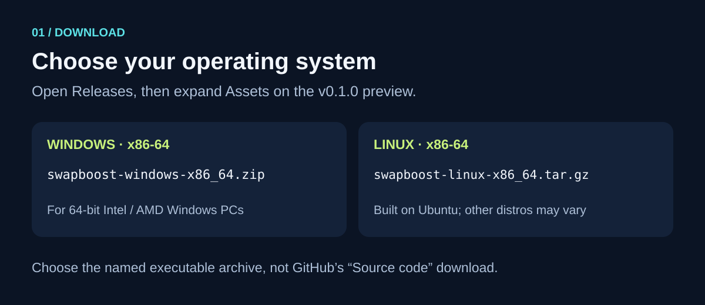
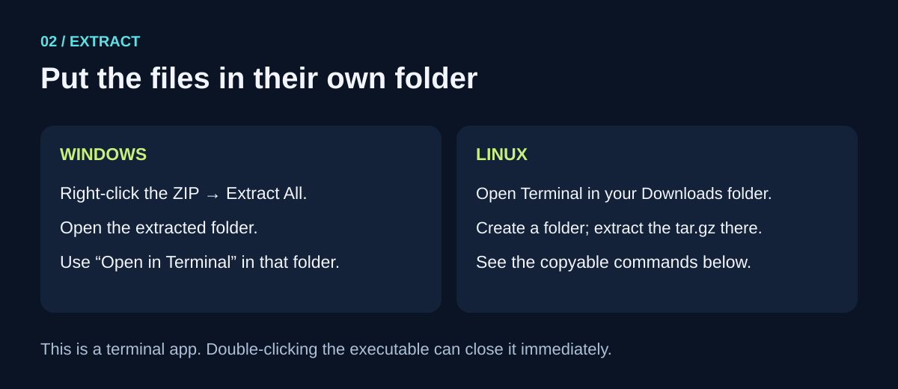
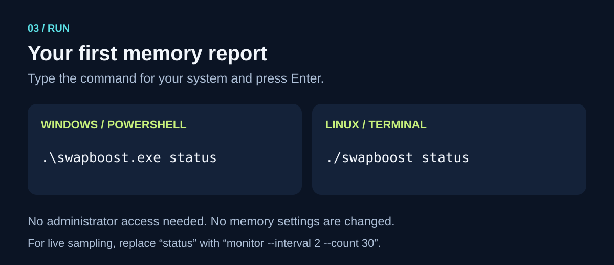
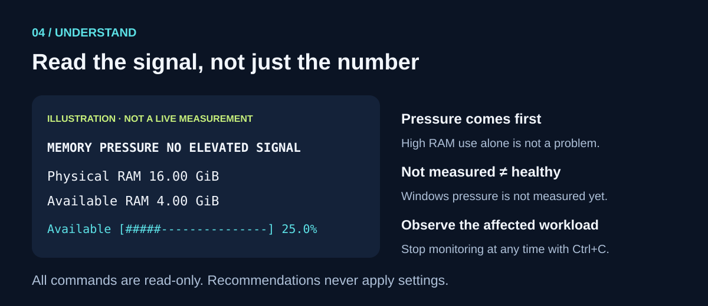

# Run SwapBoost: a picture guide

**Download → extract → run → understand.** This guide is for the v0.1 preview. SwapBoost is a terminal app, not a desktop window. No installer, Rust compiler, or administrator access is needed for the prebuilt downloads.

The pictures below are instructional illustrations. Example numbers are not live measurements. All commands are available as copyable text beside the images.

## 1. Download for your operating system



Open the [v0.1.0 release](https://github.com/VinayKumar-06/swapboost/releases/tag/v0.1.0). Under **Assets**, choose:

| Your computer | Download |
| --- | --- |
| Windows, Intel/AMD 64-bit | [swapboost-windows-x86_64.zip](https://github.com/VinayKumar-06/swapboost/releases/download/v0.1.0/swapboost-windows-x86_64.zip) |
| Linux, Intel/AMD 64-bit | [swapboost-linux-x86_64.tar.gz](https://github.com/VinayKumar-06/swapboost/releases/download/v0.1.0/swapboost-linux-x86_64.tar.gz) |

Downloads are public. There is no macOS build, and no ARM prebuilt binary in this release. Linux binaries use the Ubuntu CI environment's libraries; if your distribution is older, use the [source-build instructions](../README.md#build-from-source).

Each archive has a matching `.sha256` file in Assets. Verify the archive before extracting: in PowerShell run `Get-FileHash .\swapboost-windows-x86_64.zip -Algorithm SHA256` and compare the hash to the checksum file. On Linux, download the matching checksum next to the archive and run `sha256sum -c swapboost-linux-x86_64.sha256`. A checksum checks file integrity, not publisher identity. The executables are unsigned. If your security software blocks a build, do not disable its protection; review the source or wait for a signed release.

## 2. Extract and open a terminal



**Windows:** Right-click the downloaded ZIP → **Extract All**. Open the extracted folder, then right-click empty space → **Open in Terminal**. On older Windows, click the folder address bar, type `powershell`, and press Enter.

You should see `swapboost.exe`, `README.md`, `LICENSE`, and a `docs` folder. Run commands from the folder containing `swapboost.exe`; do not double-click it.

**Linux:** Open a terminal in the folder where you downloaded the archive. These commands create a new directory and extract into it:

```sh
mkdir swapboost-v0.1.0
tar -xzf swapboost-linux-x86_64.tar.gz -C swapboost-v0.1.0
cd swapboost-v0.1.0
```

If that directory already exists, choose a new empty folder instead.

## 3. Run your first report



Windows PowerShell:

```powershell
.\swapboost.exe status
```

Linux:

```sh
./swapboost status
```

The terminal shows real metrics from your computer. Nothing changes in your operating system. The cyan heading is optional: set `NO_COLOR=1` to disable color. Files and pipes automatically receive plain text.

## 4. Understand the report



- **Memory pressure** is the main signal. Linux uses PSI when available. Windows currently displays **NOT MEASURED**; that does not mean the computer is healthy or unhealthy.
- **Physical RAM** is installed memory. **Available RAM** is memory the OS can readily reuse. The bar represents the available fraction, not a health score.
- **Commit / limit** and **swap** are separate from physical RAM. They are not extra RAM and must not be added together.
- **Not available** means SwapBoost could not measure that field. It does not mean zero.
- **What to do next** is advice. SwapBoost does not apply settings.

## 5. Watch while using your computer

Start monitoring, then use the workload that usually feels slow. There is no need to create an artificial stress test.

Windows:

```powershell
.\swapboost.exe monitor --interval 2 --count 30
```

Linux:

```sh
./swapboost monitor --interval 2 --count 30
```

This prints 30 samples, roughly one minute of observations. Press **Ctrl+C** to stop earlier. Linux needs at least 30 seconds of elevated stall measurements to label pressure sustained. Monitoring keeps no history in memory and does not clear your terminal.

## 6. Save a report, if useful

Windows:

```powershell
.\swapboost.exe status --json | Out-File -Encoding utf8 report.json
```

Linux:

```sh
./swapboost status --json > report.json
```

Choose a new filename if a report already exists. Review reports before sharing; they contain machine capacity and memory readings. Nothing is uploaded automatically.

## Troubleshooting

| What you see | What to do |
| --- | --- |
| A window flashes and disappears | Open a terminal first; run the command from there. |
| “Command not found” / “not recognized” | Enter the extracted folder and keep the `./` or `.\` prefix. |
| Linux “Permission denied” | For a verified download, run `chmod u+x ./swapboost`, then retry. Do not use sudo. |
| Linux GLIBC version error | Build from source on that distribution. |
| “Not available” / “NOT MEASURED” | Read Measurement limits; unsupported fields are expected. |
| macOS “not supported” | Monitoring supports Windows and Linux only. |
| Unsigned-app warning | Review source or wait for signing; do not disable security protections. |

For help, [open a bug report](https://github.com/VinayKumar-06/swapboost/issues/new?template=bug_report.yml). Include your OS, version, command, and error text without private data.

To uninstall a prebuilt download, delete its extracted folder. No service, startup task, or system configuration is installed.
